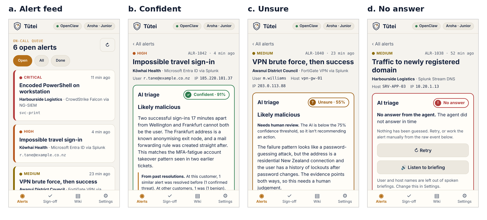
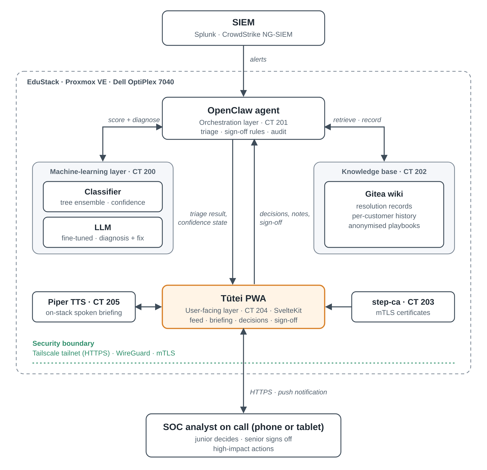

# Tūtei

*tūtei: lookout, sentry, scout*

Tūtei is a mobile multimedia **Progressive Web App (PWA)** for on-call security analysts. A SIEM raises an alert, an **OpenClaw** agent triages it, and Tūtei puts the verdict, the evidence and the customer's past resolutions in the analyst's hand. The analyst approves, rejects or escalates; risky decisions go to a senior for sign-off; every resolution is saved to the knowledge base and the team's Gitea wiki, so the next similar alert learns from it.

Tūtei is the user-facing layer of the **EduStack**, a small enterprise stack on Proxmox VE built for the NMIT Master of IT (IT8530 Advanced Mobile Application Solutions).



## Contents

- [Features](#features)
- [Architecture](#architecture)
- [Quick start (demo data)](#quick-start-demo-data)
- [Run with the server](#run-with-the-server)
- [Configuration](#configuration)
- [Deploy on the EduStack](#deploy-on-the-edustack)
- [Try it](#try-it)
- [Evaluation mode](#evaluation-mode)
- [Project structure](#project-structure)
- [Further documentation](#further-documentation)
- [Acknowledgements](#acknowledgements)

## Features

**AI triage with three honest states**

| State | When | What the analyst sees |
| --- | --- | --- |
| Confident | Confidence at or above the analyst's threshold (default 75%) | Verdict, diagnosis, suggested action and its impact |
| Unsure | Below the threshold | "Needs human review"; the suggested action is hidden until the analyst asks to see it |
| No answer | Timeout or error | "Nothing has been guessed", **Retry**, and the raw SIEM event |

**Multimedia**

- Alert sounds, with a distinct sound for critical alerts and adjustable volume
- Spoken alerts and briefings (text-to-speech), with stop, rate and voice choice; user and host names are left out of speech by default
- Natural New Zealand English voices generated on the stack by Piper, with device voices as a fallback
- Vibration patterns by severity (where the browser supports it)
- Animated event timeline and activity chart
- Voice notes on decisions
- System notifications (on iPhone, after **Add to Home Screen**)

**Workflow and knowledge**

- Senior sign-off for high-impact actions and for junior analysts' decisions; seniors approve or send back with a comment
- Past resolutions on the alert screen: the same customer's in full, other customers' only as anonymised playbooks
- Resolution records written to a Gitea wiki over mutual TLS
- Audit trail on every alert

**Design and accessibility**

- Severity and confidence always shown in words, not colour alone (WCAG 2.2 AA)
- 48 px buttons, screen-reader labels and live status regions
- Light, dark and system themes; reduced motion honoured
- Phone layout with bottom tabs; tablet layout with a navigation rail and list and detail side by side
- Lightweight mode (text first, no animation or charts), switched on automatically on data-saver connections
- Installable PWA with an offline app shell

## Architecture



*The target architecture from Assessment 1. As built, Tūtei's own server holds the knowledge base and writes the Gitea wiki, and the agent's confidence comes from the language model; the tree-ensemble classifier is not yet in the loop.*

| Container | Role |
| --- | --- |
| CT 204 `tutei` | This repository: the PWA and its Node server (`/api`) |
| CT 201 `openclaw-gw` | OpenClaw agent: triages each alert through its OpenAI-compatible endpoint |
| CT 200 `inference` | Gemma model served by llama.cpp, used by OpenClaw |
| CT 202 `gitea` | Gitea wiki for resolution records, behind an nginx mutual-TLS gateway |
| CT 203 `step-ca` | Certificate authority for server and client certificates |
| CT 205 `tts` | Piper text-to-speech |

The app talks only to its own server on the same origin. The server holds the alerts, knowledge base and sign-off policy, asks OpenClaw for each triage, writes the wiki and collects evaluation events. The phone reaches it only over the tailnet (Tailscale, HTTPS).

The OpenClaw agent may only choose from the actions Tūtei offers, and Tūtei, not the agent, decides each action's impact and who must sign off. Alert text is passed to the agent as data, with an instruction not to follow anything inside it.

## Quick start (demo data)

Requires **Node.js 20 or newer**.

```bash
git clone https://github.com/jasam013/Tuutei.git
cd Tuutei
npm install
npm run dev
```

Open the address Vite prints (for example `http://localhost:5173`). The app starts in **demo-data mode**: a built-in stand-in for the agent runs in the browser, so no server or stack is needed. To open it on a phone on the same network, use the network address Vite prints.

## Run with the server

The server (`server/mock-api.js`) serves the built app and the `/api` contract. Without any configuration it uses a scripted stand-in for the agent and keeps its state in memory; set the variables below to connect it to OpenClaw, Gitea and Piper.

```bash
npm run build          # static app in build/
npm start              # app and API on http://localhost:8787
```

For development with hot reload, run `npm start` in one terminal and `npm run dev` in another; Vite forwards `/api` to the server.

In the app, open **Settings → Data source → OpenClaw API**, keep the base URL as `/api`, and tap **Test connection**.

## Configuration

All configuration is through environment variables on the server. Copy `.env.example` and fill in what you use; never commit real tokens.

| Variable | Default | Purpose |
| --- | --- | --- |
| `PORT` | `8787` | Server port |
| `TUTEI_DATA_DIR` | (memory only) | Folder for `state.json` and `eval-events.jsonl` |
| `TUTEI_OPENCLAW_URL` | (scripted triage) | OpenClaw gateway, e.g. `http://192.168.100.21:18789` |
| `TUTEI_OPENCLAW_TOKEN` | | Gateway token |
| `TUTEI_OPENCLAW_AGENT` | `default` | Agent id, sent as model `openclaw/<id>` |
| `TUTEI_OPENCLAW_TIMEOUT_MS` | `60000` | After this the analyst sees "No answer from the agent" |
| `TUTEI_SCRIPTED_FAILURE` | on | `off` stops alert ALR-1038 failing twice (it exists for usability task T4) |
| `TUTEI_GITEA_URL` | (wiki off) | Gitea base URL, e.g. `https://gitea.edustack.internal:3000` |
| `TUTEI_GITEA_REPO` | | `owner/repo` whose wiki receives records |
| `TUTEI_GITEA_TOKEN` | | Gitea access token with repository write scope |
| `TUTEI_GITEA_PUBLIC_URL` | `TUTEI_GITEA_URL` | Address used in links shown to analysts |
| `TUTEI_GITEA_CA`, `TUTEI_GITEA_CERT`, `TUTEI_GITEA_KEY` | | CA certificate, client certificate and key for the mutual-TLS gateway (P-384) |
| `TUTEI_TTS_URL` | (device voices only) | Piper service, e.g. `http://192.168.100.25:5000` |
| `TUTEI_API_TARGET` | `http://localhost:8787` | Development only: where Vite forwards `/api` |

To test the OpenClaw connection from the server alone:

```bash
set -a; . /etc/tutei/openclaw.env; set +a
node server/openclaw-check.js
```

## Deploy on the EduStack

On CT 204 (Debian, Node.js 20):

```bash
git clone https://github.com/jasam013/Tuutei.git /opt/tutei
cd /opt/tutei && npm ci && npm run build
```

`/etc/systemd/system/tutei.service`:

```ini
[Unit]
Description=Tutei PWA and agent API
After=network-online.target

[Service]
WorkingDirectory=/opt/tutei
ExecStart=/usr/bin/node server/mock-api.js
Environment=PORT=8080
Environment=TUTEI_DATA_DIR=/var/lib/tutei
StateDirectory=tutei
EnvironmentFile=-/etc/tutei/openclaw.env
EnvironmentFile=-/etc/tutei/gitea.env
Environment=TUTEI_TTS_URL=http://192.168.100.25:5000
Restart=on-failure
DynamicUser=yes

[Install]
WantedBy=multi-user.target
```

```bash
systemctl daemon-reload && systemctl enable --now tutei
journalctl -u tutei -n 3     # the start-up line lists triage, wiki, voice and state settings
```

Publish it to the tailnet only, over HTTPS, with Tailscale Serve on the Proxmox host. Keep the env files mode 600; they hold the gateway and Gitea tokens.

After a host restart, the EduStack needs its encrypted volumes unlocked and the CA started before triage and wiki writes work; see `OPENCLAW.md` and `WIKI.md`.

## Try it

1. As **Aroha (junior)**, open **Settings** and tap **Simulate an incoming alert**. A critical alert arrives with a sound and a spoken summary.
2. Open it. While the agent works, the triage card counts seconds; read **What happened** meanwhile.
3. The verdict is **Confident**. Choose **Approve suggested action**. Isolating a host changes production, so Tūtei sends it to a senior and lists why.
4. Open *VPN brute force, then success*. It is **Unsure**: the suggestion is hidden. Scroll to **Past resolutions** and open INC-2104.
5. Open *Traffic to newly registered domain*. The agent does not answer. Tap **Retry** until it recovers.
6. In **Settings**, switch to **Jason (senior)**. On **Sign-off**, approve the request or send it back with a comment.
7. Open **Wiki** to see the new resolution record, and its page in Gitea when the wiki is configured.

## Evaluation mode

For usability testing (IT8530 Assessments 2 and 3), **Settings → Evaluation mode** records what the analyst does and when, tagged with a participant code (never a name) and the current task (T1 to T7). Events go to the server in API mode, or stay on the device in demo-data mode, and download as a CSV.

Before each participant: **Reset demo data**, **Clear log**, set the role to Junior, then switch on **Record this session**.

## Project structure

```
src/
  routes/              Screens: alert feed and detail, sign-off, wiki, settings
  lib/
    api/               HTTP client and demo-data client
    components/        Confidence badge, severity tag, timeline, activity chart, voice note
    mock/              Demo-data stand-in for the agent and knowledge base (also used by the server)
    policy.js          Confidence states and sign-off rules
    media.js           Speech, haptics and notifications
    sound.svelte.js    Alert sounds
    eval.svelte.js     Evaluation-mode event logging
  service-worker.js    Offline app shell and notification clicks
server/
  mock-api.js          Server: static app, /api routes, persistence
  openclaw.js          OpenClaw adapter (prompt, JSON parsing, timeouts)
  openclaw-check.js    One-shot connection test
  wiki.js              Gitea wiki writer (mutual TLS)
  eval.js              Evaluation event store and CSV export
docs/                  Screenshots and the architecture figure
API.md                 API contract between the app and the server
OPENCLAW.md            Connecting to the live agent
WIKI.md                Gitea wiki and mutual-TLS setup
TTS.md                 Piper natural voices
```

## Further documentation

- **API.md**: every endpoint, request and response
- **OPENCLAW.md**: enabling the gateway endpoint, the token, timeouts and what the agent can and cannot do
- **WIKI.md**: Gitea wiki setup, client certificates and troubleshooting
- **TTS.md**: Piper voice service

## Acknowledgements

All alerts, customers, people and hosts in the demo data are invented.

Developed by Jason Sam for IT8530 at NMIT, with Anthropic's Claude used as a coding and writing assistant, in line with the course's acceptable-use guidance.

Coursework; all rights reserved.
